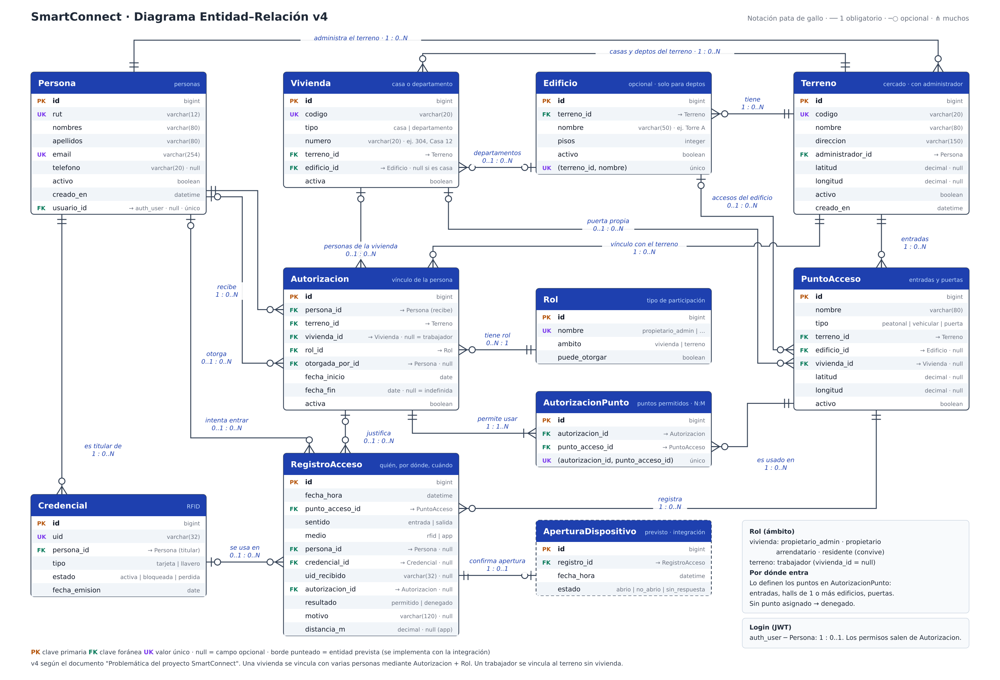

# SmartConnect · API de acceso residencial

Proyecto de Programación Back End
API REST con **Django** y **Django REST Framework**, probada en Apidog.

**Equipo:**

| Módulo | Rama | Responsable |
|---|---|---|
| CRUD Personas | `feature/personas` | Matias Cavieres |
| CRUD Viviendas | `feature/viviendas` | Matias Quiroz |
| CRUD Terrenos | `feature/terrenos` | Matias Quiroz |
| CRUD Puntos de acceso | `feature/puntos-acceso` | Matias Quiroz |
| Login JWT y permisos | `feature/jwt-permisos` | Matias Quiroz |
| Operación: asignar persona a vivienda | `feature/asignaciones` | Matias Cavieres |
| Documentación, ER v4 y colección Apidog | `feature/documentacion` | Matias Cavieres |

---

## 1. Problemática

SmartConnect centraliza el acceso a varios **terrenos** o conjuntos residenciales
cercados. Cada terreno tiene un **administrador**, varios **puntos de acceso**
(peatonales, rejas vehiculares, portones) y contiene **casas** o **departamentos**
dentro de edificios.

Una persona puede estar vinculada con varias viviendas, en uno o varios terrenos, y
una misma vivienda puede tener varias personas: el **propietario administrador**,
otros **propietarios**, **arrendatarios** y quienes **conviven** ahí. Los terrenos
también tienen **trabajadores** que necesitan entrar aunque no tengan vivienda.

Las personas entran con una **credencial RFID** (tarjeta o llavero) o pidiendo una
apertura desde una **app**. La API debe recibir la solicitud, identificar el medio y
el punto de acceso, comprobar si la persona está autorizada para **ese punto** y
**registrar el resultado** (permitido o denegado), para luego consultar quién intentó
entrar, por dónde, cuándo y con qué resultado.

### Respuestas a las preguntas de diseño

**¿Una vivienda puede tener varios propietarios?**
Sí. La relación Persona–Vivienda es **N:M** y se resuelve con **Autorizacion**, que
indica el **rol** de la persona en esa vivienda: `propietario_admin`, `propietario`,
`arrendatario` o `residente`. El rol depende de la vivienda: una persona puede ser
propietaria de una casa y arrendataria de un departamento en otro terreno.

**¿Qué relación tiene una credencial con una persona?**
Cada credencial es **personal**: tiene **un solo titular**, y una persona puede tener
**varias** (tarjeta, llavero). Es **1:N**. No se comparten, para que el historial
siempre sepa quién pasó. Tiene un estado (`activa`, `bloqueada`, `perdida`), así que
se desactiva sin borrarla.

**¿Qué punto de acceso pertenece a una vivienda y cuál es compartido?**
Todo punto pertenece a un **terreno**. Si solo tiene terreno, es una **entrada
compartida** del terreno. Si tiene **edificio**, es un acceso de esa torre (hall).
Si tiene **vivienda**, es la puerta privada de esa casa o departamento.

### Supuestos del equipo

1. Solo se usan **datos ficticios** (nombres, RUT con dígito verificador válido, correos `@smartconnect.test`).
2. RUT y email de una persona son únicos.
3. Cada **terreno** tiene **un administrador** (`Terreno.administrador`). Una persona puede administrar varios terrenos.
4. Una **casa** va directo en el terreno. Un **departamento** está dentro de un **edificio** del terreno.
5. Toda relación de una persona con una vivienda o un terreno es una **Autorizacion** con un **Rol**.
6. Cada vivienda tiene un **propietario administrador**, que incorpora a las demás personas (`otorgada_por`).
7. Quien **convive** sin ser dueño ni arrendatario (pareja, hijos) tiene el rol **`residente`**.
8. Un **trabajador** se vincula al **terreno** sin vivienda (`vivienda = null`). Puede tener acceso a las entradas y a los halls de uno o varios edificios.
9. **Administrar el terreno** (`Terreno.administrador`) y **administrar las personas de una vivienda** (rol `propietario_admin`) son responsabilidades distintas.
10. Una persona solo puede pasar por los **puntos asignados** a su autorización (AutorizacionPunto), mientras esté **vigente**. Si no, se **deniega**.
11. Todos los intentos, permitidos o denegados, se guardan en **RegistroAcceso**, incluso con una **credencial desconocida** (se guarda el UID recibido y el motivo).
12. La **cercanía** desde la app se **simula** por ahora (`distancia_m`). La confirmación física de apertura (**AperturaDispositivo**) queda prevista para la integración.
13. **Login con JWT (Entrega 2)**: cada cuenta de Django (`User`) se vincula con **una** persona (`Persona.usuario`, 1 : 0..1). Las cuentas se crean en Django Admin o con `cargar_datos`. Una cuenta sin persona (o con la persona desactivada) puede iniciar sesión pero no ve ni cambia nada.
14. **El JWT identifica; los permisos deciden.** Alcance de cada actor:
    - *Personal de SmartConnect* (`is_staff`): ve y administra todo. Es el único que crea o borra terrenos, borra personas y cambia el administrador de un terreno.
    - *Administrador del terreno* (`Terreno.administrador`): administra el terreno, sus viviendas y sus puntos de acceso, y ve a las personas vinculadas a su terreno. **No** asigna personas a las viviendas (supuesto 9).
    - *Propietario administrador* (rol `propietario_admin`): asigna y revoca personas **solo en las viviendas que administra**.
    - *Cualquier otra persona*: ve únicamente lo que la vincula (sus viviendas, su terreno, los puntos que tiene permitidos) y edita sus propios datos de contacto.
15. Solo cuentan las autorizaciones **vigentes** (activas y con fecha de hoy dentro del rango): un arriendo vencido o revocado no da alcance.
16. Cada vivienda tiene un solo propietario administrador. El primero lo asigna el personal de SmartConnect; después él incorpora a los demás.
17. Un propietario administrador no puede dar acceso por puntos que él mismo no tiene en esa vivienda.

---

## 2. Diagrama Entidad–Relación



Fuente editable: [`docs/diagrama_er_v4.svg`](docs/diagrama_er_v4.svg). Cambio de la v4 respecto de la v3: `Persona.usuario_id` → `auth_user` (cuenta de login, 1 : 0..1). No hay tablas nuevas: los permisos se calculan con `Autorizacion` y `Terreno.administrador`. La v3 queda en `docs/diagrama_er_v3.*`.

### Entidades

| Entidad | Qué guarda |
|---|---|
| Persona | Datos ficticios de quienes participan en el sistema y, si tiene, su cuenta de login |
| Credencial | UID RFID único, titular y estado |
| Terreno | Conjunto residencial cercado, su administrador y ubicación |
| Edificio | Torre o block dentro de un terreno (solo para departamentos) |
| Vivienda | Casa o departamento, su terreno y su edificio |
| Rol | Tipo de participación y su ámbito (vivienda o terreno) |
| Autorizacion | Vínculo de una persona con un terreno y, si corresponde, con una vivienda |
| AutorizacionPunto | Puntos de acceso que permite cada autorización (N:M) |
| PuntoAcceso | Entradas del terreno, accesos de edificio y puertas de vivienda |
| RegistroAcceso | Historial de intentos: quién, por dónde, cuándo, medio y resultado |
| AperturaDispositivo | Confirmación de que el dispositivo abrió (prevista, para la integración) |

### Roles

| Rol | Ámbito | Puede otorgar | Descripción |
|---|---|---|---|
| `propietario_admin` | vivienda | sí | Dueño que administra las personas de su vivienda |
| `propietario` | vivienda | no | Copropietario |
| `arrendatario` | vivienda | no | Arrienda la vivienda |
| `residente` | vivienda | no | Convive sin ser dueño ni arrendatario |
| `trabajador` | terreno | no | Conserje, guardia, jardinero… sin vivienda |

### Relaciones y cardinalidades

| Relación | Cardinalidad | Por qué |
|---|---|---|
| Persona — auth_user (cuenta) | **0..1 : 0..1** | Una persona puede tener una cuenta de login y cada cuenta es de una sola persona. |
| Persona (administrador) — Terreno | **1 : 0..N** | Cada terreno tiene un administrador. Una persona puede administrar varios. |
| Terreno — Edificio | **1 : 0..N** | Un terreno de casas no tiene edificios. |
| Terreno — Vivienda | **1 : 0..N** | Toda vivienda está en un terreno. |
| Edificio — Vivienda | **0..1 : 0..N** | Un departamento está en un edificio. Una casa no. |
| Persona — Autorizacion | **1 : 0..N** | Una persona puede estar vinculada con varias viviendas y terrenos. |
| Vivienda — Autorizacion | **0..1 : 0..N** | Una vivienda tiene varias personas. Un trabajador no tiene vivienda. |
| Terreno — Autorizacion | **1 : 0..N** | Toda autorización es de un terreno. |
| Rol — Autorizacion | **1 : 0..N** | Cada vínculo tiene un rol. |
| Persona (otorga) — Autorizacion | **0..1 : 0..N** | El propietario administrador incorpora a otras personas. |
| Autorizacion — AutorizacionPunto — PuntoAcceso | **N:M** | Cada autorización permite uno o más puntos, y un punto está en muchas autorizaciones. |
| Terreno / Edificio / Vivienda — PuntoAcceso | **1 / 0..1 / 0..1 : 0..N** | Entrada del terreno, acceso de edificio o puerta de vivienda. |
| Persona — Credencial | **1 : 0..N** | Credencial personal, no compartida. |
| PuntoAcceso — RegistroAcceso | **1 : 0..N** | Todo intento ocurre en un punto. |
| Persona / Credencial / Autorizacion — RegistroAcceso | **0..1 : 0..N** | Se guardan cuando se conocen. Con una credencial desconocida quedan en null y se guarda `uid_recibido`. |
| RegistroAcceso — AperturaDispositivo | **1 : 0..1** | Autorizar y confirmar que abrió son eventos distintos. |

### Decisiones de diseño

- **Autorizacion + Rol en vez de un propietario fijo en Vivienda**: una vivienda tiene varias personas con roles distintos, y el rol depende de la vivienda.
- **Trabajador con `vivienda = null`**: se vincula al terreno, y sus puntos definen si entra a uno o a varios edificios.
- **AutorizacionPunto (N:M)**: el acceso se da **punto por punto**. Así una persona puede entrar por la peatonal y ser denegada en la reja vehicular.
- **Edificio opcional**: el mismo modelo sirve para terrenos de casas, de departamentos o mixtos.
- **Administrador del terreno ≠ propietario administrador**: uno gestiona el terreno y sus trabajadores, el otro las personas de su vivienda.
- **Credencial personal**: se comparten los permisos, no las tarjetas. Así el historial siempre sabe quién pasó.
- **RegistroAcceso guarda también los rechazos** con su `motivo` y el `uid_recibido`, para responder "quién intentó entrar, por dónde, cuándo y con qué resultado".
- **AperturaDispositivo separado**: que la API autorice no significa que la puerta abrió.

### Regla de acceso

Una persona puede pasar por un punto si tiene una **credencial activa** (o usa la app)
y una **Autorizacion vigente** que incluya **ese punto**. Vigente significa
`activa = true` y la fecha de hoy entre `fecha_inicio` y `fecha_fin` (si `fecha_fin`
está vacía, no vence). Si el punto no está asignado, el intento queda **denegado**
con su motivo.

### Situaciones del documento

| Situación | Cómo se representa |
|---|---|
| Persona con viviendas en dos terrenos | Dos Autorizaciones, cada una con su terreno, vivienda y rol |
| Propietario administrador incorpora a un arrendatario | Autorizacion rol `arrendatario` con `otorgada_por` = propietario admin |
| Una persona administra varios terrenos | Varios Terreno con el mismo `administrador` |
| Trabajador sin vivienda | Autorizacion rol `trabajador`, `vivienda = null`, con sus puntos |
| Entra por un acceso y lo deniegan en otro | Un punto está en AutorizacionPunto y el otro no: `permitido` / `denegado` |
| Historial por persona, terreno, punto y fecha | Filtros sobre RegistroAcceso (`persona`, `punto_acceso → terreno`, `fecha_hora`) |

---

## 3. Base de datos inicial

Implementa el **diagrama entidad–relación** con Django 6.1 + Django REST Framework 3.18 sobre SQLite.

### Levantar el proyecto

```bash
python3 -m venv .venv
source .venv/bin/activate          # PowerShell: .venv\Scripts\Activate.ps1
python -m pip install -r requirements.txt
python manage.py migrate           # crea la BD desde las migraciones (incluye 0002_persona_usuario)
python manage.py cargar_datos      # carga los datos ficticios y las cuentas de login
python manage.py runserver
```

`requirements.txt` ahora incluye `djangorestframework-simplejwt` (JWT). Si ya tenías el entorno armado, ejecuta de nuevo `python -m pip install -r requirements.txt`.

Para borrar todo y volver a cargar: `python manage.py cargar_datos --reset`.
Para ver los datos en el admin de Django: `python manage.py createsuperuser` y después entrar a `http://127.0.0.1:8000/admin/`.

### Apps y tablas

| App | Modelos (tablas) |
|---|---|
| `personas` | Persona, Credencial |
| `viviendas` | Terreno, Edificio, Vivienda |
| `accesos` | Rol, PuntoAcceso, Autorizacion, AutorizacionPunto, RegistroAcceso, AperturaDispositivo |

- Esquema SQL generado desde las migraciones: [`docs/esquema_inicial.sql`](docs/esquema_inicial.sql)
- Datos ficticios exportados: [`docs/datos_iniciales.json`](docs/datos_iniciales.json) (incluye las cuentas de login; se cargan en una base recién migrada con `python manage.py loaddata docs/datos_iniciales.json`)

### Reglas que valida la base de datos

| Regla | Dónde |
|---|---|
| RUT, email, UID de credencial, código de terreno y de vivienda son únicos | `unique=True` |
| Un edificio no repite su nombre dentro del terreno | `UniqueConstraint` |
| Una **casa** no tiene edificio y un **departamento** sí | `CheckConstraint` |
| Un punto de acceso es del terreno, de un edificio **o** de una vivienda, nunca de ambos | `CheckConstraint` |
| `fecha_fin` no puede ser anterior a `fecha_inicio` | `CheckConstraint` |
| Una autorización no repite el mismo punto | `UniqueConstraint` |
| Una cuenta de login pertenece a una sola persona | `Persona.usuario` es `OneToOneField` |
| Un rol de ámbito vivienda exige `vivienda_id`; `trabajador` no lleva vivienda | `Autorizacion.clean()` |
| La vivienda, el edificio y los puntos deben ser del mismo terreno | `clean()` |
| No se puede dar acceso a la puerta de otra vivienda | `AutorizacionPunto.clean()` |
| No se borra una persona, un terreno o un punto con historial | `on_delete=PROTECT` |

### Datos ficticios cargados

| Tabla | Cantidad | Ejemplos |
|---|---|---|
| Persona | 8 | Carlos (admin), Ana, Benjamín, Sofía, Pedro, Ema, Valentina, Lucas |
| Terreno | 2 | Condominio Los Robles, Condominio El Bosque (ambos administrados por Carlos) |
| Edificio | 2 | Torre A, Torre B (Los Robles) |
| Vivienda | 5 | Deptos A-101, A-102, B-201 · Casa 7, Casa 3 (El Bosque) |
| Rol | 5 | propietario_admin, propietario, arrendatario, residente, trabajador |
| PuntoAcceso | 10 | Peatonal Norte, Reja Vehicular, Portón Sur, Hall Torre A/B, Puerta A-101/A-102, Portón Principal, Peatonal El Bosque, Puerta Casa 7 |
| Autorizacion | 9 | Ana (prop. admin ×2), Benjamín (arrendatario + prop. admin en otro terreno), Sofía (trabajadora), Pedro, Ema (residente), Valentina, Lucas (vencida) |
| AutorizacionPunto | 28 | Puntos permitidos de cada autorización |
| Credencial | 9 | Tarjetas y llaveros (la de Lucas, bloqueada) |
| RegistroAcceso | 13 | Permitidos, denegados, credencial desconocida, por app con distancia |
| AperturaDispositivo | 7 | `abrio` y un `sin_respuesta` |
| Cuentas de login | 9 | Una por persona (`carlos`, `ana`, `benja`, `sofi`, `pedro`, `ema`, `vale`, `lucas`) y `soporte` (personal de SmartConnect). Contraseña de todas: `smart1234` |

### Situaciones del documento en los datos

| Situación | Datos |
|---|---|
| Persona con viviendas en dos terrenos | Benjamín: `arrendatario` del A-101 (Los Robles) y `propietario_admin` de la Casa 3 (El Bosque) |
| Propietario administrador incorpora a un arrendatario | Ana → Benjamín en el A-101 (`otorgada_por` = Ana) |
| Persona que administra varios terrenos | Carlos administra Los Robles y El Bosque |
| Trabajador sin vivienda | Sofía: `trabajador`, sin vivienda, con Peatonal Norte, Hall Torre A y Hall Torre B |
| Entra por un acceso y lo deniegan en otro | Sofía: Peatonal Norte **permitido** y Reja Vehicular **denegado** ("Punto de acceso no autorizado") |
| Quien convive sin ser dueño ni arrendatario | Ema: `residente` de la Casa 7, autorizada por su papá Pedro |
| Credencial desconocida | UID `04FFFFFFFF` en la Peatonal Norte, denegado ("Credencial desconocida") |
| Historial por persona, terreno, punto y fecha | 13 intentos de ayer en 2 terrenos y 7 puntos distintos |

---

## 4. Cuatro CRUD maestros

Todas las rutas **exigen token JWT** (sección 5). Cada recurso permite listar, ver detalle, crear, actualizar (PUT y PATCH) y eliminar.

| Recurso | Rutas | Filtros |
|---|---|---|
| **Personas** | `GET/POST /api/personas/` · `GET/PUT/PATCH/DELETE /api/personas/{id}/` | `?buscar=texto&activo=true` |
| **Terrenos** | `GET/POST /api/terrenos/` · `GET/PUT/PATCH/DELETE /api/terrenos/{id}/` | `?buscar=texto&administrador=1&activo=true` |
| **Viviendas** | `GET/POST /api/viviendas/` · `GET/PUT/PATCH/DELETE /api/viviendas/{id}/` | `?terreno=1&edificio=1&tipo=casa&activa=true` |
| **Puntos de acceso** | `GET/POST /api/puntos-acceso/` · `GET/PUT/PATCH/DELETE /api/puntos-acceso/{id}/` | `?terreno=1&edificio=1&vivienda=1&tipo=peatonal&ambito=vivienda&activo=true&buscar=texto` |
| Apoyo | `GET /api/edificios/` (solo lectura) | |

### Qué valida cada CRUD

**Personas** (`personas/serializers.py`)
- El RUT se acepta como `18765432-7` o `18.765.432-7`, se valida el **dígito verificador** y se guarda con puntos.
- RUT y email únicos. El email se guarda en minúsculas.
- El detalle muestra los **vínculos** de la persona: rol, terreno, vivienda y si está vigente.

**Terrenos** (`viviendas/serializers.py`)
- El código se guarda en mayúsculas y es único **sin distinguir mayúsculas** (`tr-robles` = `TR-ROBLES`).
- El administrador debe ser una persona **activa**.
- Latitud (−90 a 90) y longitud (−180 a 180) se informan **juntas** o ninguna, también en PATCH.
- El detalle muestra los edificios, el total de viviendas y el total de puntos de acceso.

**Viviendas** (`viviendas/serializers.py`)
- Una **casa** no lleva edificio, un **departamento** sí.
- El edificio debe ser **del mismo terreno**. También se valida en PATCH, combinando con los datos actuales.
- El código se guarda en mayúsculas y es único sin distinguir mayúsculas. El detalle muestra las **personas** de la vivienda con su rol.

**Puntos de acceso** (`accesos/serializers.py`)
- Un punto es del terreno, de **un edificio o de una vivienda**, nunca de ambos, y el edificio o la vivienda deben ser del mismo terreno.
- El nombre no se repite dentro de un terreno. Latitud y longitud van juntas.
- Un punto ya asignado a autorizaciones **no se cambia** de terreno ni de vivienda: se desactiva.
- El detalle muestra el `ambito` (terreno, edificio o vivienda) y las **personas autorizadas** (autorizaciones vigentes que lo incluyen).

**Todos:** si se intenta borrar algo con datos relacionados (una persona con credenciales o autorizaciones, un terreno con viviendas, una vivienda con personas, un punto asignado o con historial), la API responde **409 Conflict** con un mensaje, en vez de un error 500. Lo correcto en ese caso es desactivar con `PATCH {"activo": false}` (`"activa"` en viviendas).

---

## 5. Login JWT y permisos

### Obtener y usar el token (Apidog)

```
POST /api/token/            {"username": "ana", "password": "smart1234"}   ->  200 {"access": "...", "refresh": "..."}
GET  /api/viviendas/        Authorization: Bearer <access>                 ->  200
POST /api/token/refresh/    {"refresh": "<refresh>"}                       ->  200 {"access": "..."}
```

El `access` dura 30 minutos y el `refresh` 1 día (`SIMPLE_JWT` en `config/settings.py`). Sin token, con un token inválido o con el `refresh` usado como `access`, la API responde **401**.

### Cuentas de prueba (contraseña `smart1234`)

| Cuenta | Quién es | Qué puede hacer |
|---|---|---|
| `soporte` | Personal de SmartConnect (`is_staff`) | Todo |
| `carlos` | Administrador de Los Robles y El Bosque | Gestiona terrenos, viviendas y puntos de **sus** terrenos |
| `ana` | Propietaria admin de A-101 y A-102 | Asigna y revoca personas en **esas** viviendas |
| `benja` | Arrendatario de A-101 y propietario admin de la Casa 3 | Asigna solo en la Casa 3 |
| `vale` | Propietaria admin de B-201 | Asigna solo en B-201 |
| `pedro` | Propietario admin de la Casa 7 | Asigna solo en la Casa 7 |
| `ema` | Residente de la Casa 7 | Ve lo suyo y edita sus datos de contacto |
| `sofi` | Trabajadora de Los Robles (sin vivienda) | Ve el terreno y los puntos que tiene permitidos |
| `lucas` | Arriendo vencido en B-201 | No tiene alcance (solo ve su asignación vencida) |

Para crear otra cuenta: `python manage.py createsuperuser` o Django Admin (`/admin/` → Users) y luego, en **Personas**, elegir esa cuenta en el campo *Usuario* de la persona.

### Qué decide cada respuesta

| Situación | Respuesta |
|---|---|
| Sin token o token inválido | **401** |
| Token válido, acción permitida | **200 / 201 / 204**, con el resultado guardado |
| Token válido, **listado** | Solo los registros que la persona puede ver |
| Token válido, **un registro** o acción fuera de su alcance | **403** |

| Recurso | Quién lo ve | Quién lo crea | Quién lo modifica | Quién lo elimina |
|---|---|---|---|---|
| Terreno | Personal, su administrador y quien tenga autorización vigente en él | Personal | Personal o su administrador (solo el personal cambia el administrador) | Personal |
| Vivienda | Personal, administrador del terreno y personas con autorización vigente en ella | Personal o administrador del terreno | Personal o administrador del terreno | Personal o administrador del terreno |
| Punto de acceso | Personal, administrador del terreno y personas que lo tienen permitido | Personal o administrador del terreno | Personal o administrador del terreno | Personal o administrador del terreno |
| Persona | Personal, ella misma y quienes administra (terreno o vivienda) | Personal, administradores de terreno y propietarios administradores | Personal o ella misma (RUT y `activo` solo el personal) | Personal |

Las reglas están en `config/permisos.py`; cada ViewSet declara su política.

---

## 6. Operación del negocio: asignar una persona a una vivienda

`POST /api/asignaciones/`

```json
{"persona": 8, "vivienda": 2, "rol": "residente", "puntos_acceso": [1, 7]}
```

`rol` es el tipo de participación: `propietario_admin`, `propietario`, `arrendatario` o `residente`. `puntos_acceso` es opcional: si se omite, la persona queda vinculada pero sin accesos.

| Regla | Si no se cumple |
|---|---|
| El solicitante es el **propietario administrador vigente de esa vivienda** (o personal de SmartConnect) | **403** |
| La persona y la vivienda están activas, y el rol es de ámbito vivienda (no `trabajador`) | 400 |
| La persona **no está ya asignada** a esa vivienda (vigente) | 400 |
| La vivienda no tiene ya un propietario administrador (para asignar ese rol) | 400 |
| `fecha_fin` no es anterior a `fecha_inicio` ni a hoy | 400 |
| Los puntos son del terreno de la vivienda, están activos, no son la puerta de otra vivienda y el solicitante **los tiene** | 400 |

Al aceptar, la API guarda la autorización con `otorgada_por` = el solicitante y el terreno de la vivienda, más los puntos permitidos, todo en una transacción. **Un rechazo no cambia la base de datos.**

Otras rutas: `GET /api/asignaciones/` (filtros `?vivienda=&persona=&rol=&activa=`) · `GET /api/asignaciones/{id}/` · `POST /api/asignaciones/{id}/revocar/` (queda en el historial con `activa = false`; a un propietario administrador solo lo revoca el personal). No hay PUT, PATCH ni DELETE: una asignación no se edita ni se borra.

---

## 7. Colección de Apidog y pruebas

Archivo: [`docs/apidog_smartconnect_entrega2.json`](docs/apidog_smartconnect_entrega2.json) (formato Postman v2.1, que Apidog importa directamente). Reemplaza a la de la Entrega 1, que se conserva en [`docs/apidog_smartconnect_entrega1.json`](docs/apidog_smartconnect_entrega1.json) y ya no funciona sola porque todas las rutas piden token.

1. `python manage.py cargar_datos --reset` (deja los id siempre iguales) y `python manage.py runserver`
2. En Apidog: **Import → Postman** → elegir el archivo.
3. Ejecutar cada carpeta **en orden**. La primera petición de cada carpeta es un login que guarda el token en `{{access}}`; las demás lo envían en `Authorization: Bearer`.

| Carpeta | Qué demuestra |
|---|---|
| A · Login y JWT | Login 200, clave incorrecta 401, renovar con el refresh, ruta con token 200, sin token 401, token inválido 401 |
| B · CRUD Terrenos | Listar, buscar, crear, detalle, PUT, PATCH, borrar y los rechazos (400 y 409) |
| C · CRUD Puntos de acceso | Igual que terrenos, con las reglas de edificio y vivienda |
| D · Asignar persona a vivienda | Caso válido guardado, 5 rechazos 400 que no cambian la base, 403 por falta de autoridad, revocar |
| E · Permisos 401 y 403 | Listados filtrados, 403 en detalle ajeno, 403 al crear o modificar sin permiso, 401 sin token |
| F · CRUD Personas · G · CRUD Viviendas | Las peticiones de la Entrega 1, ahora con token |

Verificado: las 81 peticiones de la colección responden con el código esperado.

### Pruebas automáticas

```bash
python manage.py test        # 74 pruebas
```

| Archivo | Qué prueba |
|---|---|
| `personas/tests.py` | CRUD de personas |
| `viviendas/tests.py` · `viviendas/tests_terrenos.py` | CRUD de viviendas y de terrenos |
| `accesos/tests.py` | CRUD de puntos de acceso |
| `accesos/tests_seguridad.py` | Login, refresh, 401, listados filtrados y 403 por alcance |
| `accesos/tests_asignaciones.py` | La operación: caso válido, rechazos, autoridad, revocación |
