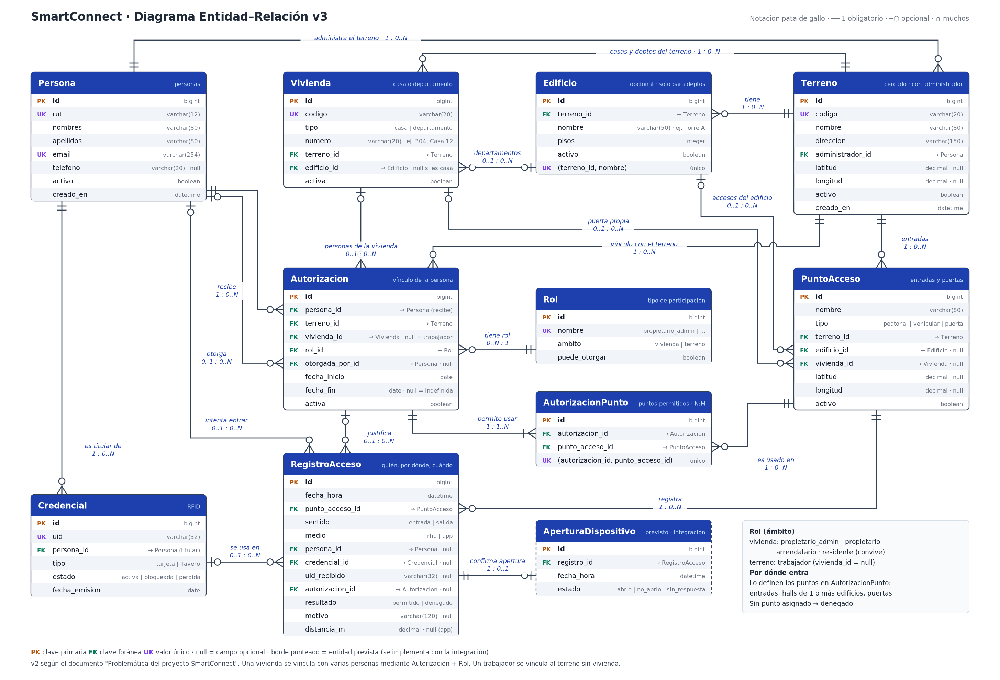

# SmartConnect · API de acceso residencial

Proyecto de Programación Back End (TI3041) · Unidad 3 · Entrega 1.
API REST con **Django** y **Django REST Framework**, probada en Apidog.

**Equipo (pareja):**

| Integrante | Módulo (CRUD) | Rama |
|---|---|---|
| Integrante 1 | Personas | `feature/personas` |
| Integrante 2 | Viviendas | `feature/viviendas` |

---

## 1. Problemática

SmartConnect centraliza el acceso a varios **terrenos** o conjuntos residenciales
cercados. Cada terreno tiene un **administrador**, varios **puntos de acceso**
(peatonales, rejas vehiculares, portones) y contiene **casas** o **departamentos**
dentro de edificios.

Una persona puede estar vinculada con varias viviendas, en uno o varios terrenos, y
una misma vivienda puede tener varias personas: el **propietario administrador**,
otros **propietarios**, **arrendatarios** y quienes **conviven** ahí. Los terrenos
también tienen **trabajadores** que necesitan entrar aunque no tengan vivienda.

Las personas entran con una **credencial RFID** (tarjeta o llavero) o pidiendo una
apertura desde una **app**. La API debe recibir la solicitud, identificar el medio y
el punto de acceso, comprobar si la persona está autorizada para **ese punto** y
**registrar el resultado** (permitido o denegado), para luego consultar quién intentó
entrar, por dónde, cuándo y con qué resultado.

### Respuestas a las preguntas de diseño

**¿Una vivienda puede tener varios propietarios?**
Sí. La relación Persona–Vivienda es **N:M** y se resuelve con **Autorizacion**, que
indica el **rol** de la persona en esa vivienda: `propietario_admin`, `propietario`,
`arrendatario` o `residente`. El rol depende de la vivienda: una persona puede ser
propietaria de una casa y arrendataria de un departamento en otro terreno.

**¿Qué relación tiene una credencial con una persona?**
Cada credencial es **personal**: tiene **un solo titular**, y una persona puede tener
**varias** (tarjeta, llavero). Es **1:N**. No se comparten, para que el historial
siempre sepa quién pasó. Tiene un estado (`activa`, `bloqueada`, `perdida`), así que
se desactiva sin borrarla.

**¿Qué punto de acceso pertenece a una vivienda y cuál es compartido?**
Todo punto pertenece a un **terreno**. Si solo tiene terreno, es una **entrada
compartida** del terreno. Si tiene **edificio**, es un acceso de esa torre (hall).
Si tiene **vivienda**, es la puerta privada de esa casa o departamento.

### Supuestos del equipo

1. Solo se usan **datos ficticios** (nombres, RUT con dígito verificador válido, correos `@smartconnect.test`).
2. RUT y email de una persona son únicos.
3. Cada **terreno** tiene **un administrador** (`Terreno.administrador`). Una persona puede administrar varios terrenos.
4. Una **casa** va directo en el terreno. Un **departamento** está dentro de un **edificio** del terreno.
5. Toda relación de una persona con una vivienda o un terreno es una **Autorizacion** con un **Rol**.
6. Cada vivienda tiene un **propietario administrador**, que incorpora a las demás personas (`otorgada_por`).
7. Quien **convive** sin ser dueño ni arrendatario (pareja, hijos) tiene el rol **`residente`**.
8. Un **trabajador** se vincula al **terreno** sin vivienda (`vivienda = null`). Puede tener acceso a las entradas y a los halls de uno o varios edificios.
9. **Administrar el terreno** (`Terreno.administrador`) y **administrar las personas de una vivienda** (rol `propietario_admin`) son responsabilidades distintas.
10. Una persona solo puede pasar por los **puntos asignados** a su autorización (AutorizacionPunto), mientras esté **vigente**. Si no, se **deniega**.
11. Todos los intentos, permitidos o denegados, se guardan en **RegistroAcceso**, incluso con una **credencial desconocida** (se guarda el UID recibido y el motivo).
12. La **cercanía** desde la app se **simula** por ahora (`distancia_m`). La confirmación física de apertura (**AperturaDispositivo**) queda prevista para la integración.
13. Login, token JWT y permisos de usuario quedan para la próxima entrega.

---

## 2. Diagrama Entidad–Relación



Fuente editable: [`docs/diagrama_er_v3.svg`](docs/diagrama_er_v3.svg)

### Entidades

| Entidad | Qué guarda |
|---|---|
| Persona | Datos ficticios de quienes participan en el sistema |
| Credencial | UID RFID único, titular y estado |
| Terreno | Conjunto residencial cercado, su administrador y ubicación |
| Edificio | Torre o block dentro de un terreno (solo para departamentos) |
| Vivienda | Casa o departamento, su terreno y su edificio |
| Rol | Tipo de participación y su ámbito (vivienda o terreno) |
| Autorizacion | Vínculo de una persona con un terreno y, si corresponde, con una vivienda |
| AutorizacionPunto | Puntos de acceso que permite cada autorización (N:M) |
| PuntoAcceso | Entradas del terreno, accesos de edificio y puertas de vivienda |
| RegistroAcceso | Historial de intentos: quién, por dónde, cuándo, medio y resultado |
| AperturaDispositivo | Confirmación de que el dispositivo abrió (prevista, para la integración) |

### Roles

| Rol | Ámbito | Puede otorgar | Descripción |
|---|---|---|---|
| `propietario_admin` | vivienda | sí | Dueño que administra las personas de su vivienda |
| `propietario` | vivienda | no | Copropietario |
| `arrendatario` | vivienda | no | Arrienda la vivienda |
| `residente` | vivienda | no | Convive sin ser dueño ni arrendatario |
| `trabajador` | terreno | no | Conserje, guardia, jardinero… sin vivienda |

### Relaciones y cardinalidades

| Relación | Cardinalidad | Por qué |
|---|---|---|
| Persona (administrador) — Terreno | **1 : 0..N** | Cada terreno tiene un administrador. Una persona puede administrar varios. |
| Terreno — Edificio | **1 : 0..N** | Un terreno de casas no tiene edificios. |
| Terreno — Vivienda | **1 : 0..N** | Toda vivienda está en un terreno. |
| Edificio — Vivienda | **0..1 : 0..N** | Un departamento está en un edificio. Una casa no. |
| Persona — Autorizacion | **1 : 0..N** | Una persona puede estar vinculada con varias viviendas y terrenos. |
| Vivienda — Autorizacion | **0..1 : 0..N** | Una vivienda tiene varias personas. Un trabajador no tiene vivienda. |
| Terreno — Autorizacion | **1 : 0..N** | Toda autorización es de un terreno. |
| Rol — Autorizacion | **1 : 0..N** | Cada vínculo tiene un rol. |
| Persona (otorga) — Autorizacion | **0..1 : 0..N** | El propietario administrador incorpora a otras personas. |
| Autorizacion — AutorizacionPunto — PuntoAcceso | **N:M** | Cada autorización permite uno o más puntos, y un punto está en muchas autorizaciones. |
| Terreno / Edificio / Vivienda — PuntoAcceso | **1 / 0..1 / 0..1 : 0..N** | Entrada del terreno, acceso de edificio o puerta de vivienda. |
| Persona — Credencial | **1 : 0..N** | Credencial personal, no compartida. |
| PuntoAcceso — RegistroAcceso | **1 : 0..N** | Todo intento ocurre en un punto. |
| Persona / Credencial / Autorizacion — RegistroAcceso | **0..1 : 0..N** | Se guardan cuando se conocen. Con una credencial desconocida quedan en null y se guarda `uid_recibido`. |
| RegistroAcceso — AperturaDispositivo | **1 : 0..1** | Autorizar y confirmar que abrió son eventos distintos. |

### Decisiones de diseño

- **Autorizacion + Rol en vez de un propietario fijo en Vivienda**: una vivienda tiene varias personas con roles distintos, y el rol depende de la vivienda.
- **Trabajador con `vivienda = null`**: se vincula al terreno, y sus puntos definen si entra a uno o a varios edificios.
- **AutorizacionPunto (N:M)**: el acceso se da **punto por punto**. Así una persona puede entrar por la peatonal y ser denegada en la reja vehicular.
- **Edificio opcional**: el mismo modelo sirve para terrenos de casas, de departamentos o mixtos.
- **Administrador del terreno ≠ propietario administrador**: uno gestiona el terreno y sus trabajadores, el otro las personas de su vivienda.
- **Credencial personal**: se comparten los permisos, no las tarjetas. Así el historial siempre sabe quién pasó.
- **RegistroAcceso guarda también los rechazos** con su `motivo` y el `uid_recibido`, para responder "quién intentó entrar, por dónde, cuándo y con qué resultado".
- **AperturaDispositivo separado**: que la API autorice no significa que la puerta abrió.

### Regla de acceso

Una persona puede pasar por un punto si tiene una **credencial activa** (o usa la app)
y una **Autorizacion vigente** que incluya **ese punto**. Vigente significa
`activa = true` y la fecha de hoy entre `fecha_inicio` y `fecha_fin` (si `fecha_fin`
está vacía, no vence). Si el punto no está asignado, el intento queda **denegado**
con su motivo.

### Situaciones del documento

| Situación | Cómo se representa |
|---|---|
| Persona con viviendas en dos terrenos | Dos Autorizaciones, cada una con su terreno, vivienda y rol |
| Propietario administrador incorpora a un arrendatario | Autorizacion rol `arrendatario` con `otorgada_por` = propietario admin |
| Una persona administra varios terrenos | Varios Terreno con el mismo `administrador` |
| Trabajador sin vivienda | Autorizacion rol `trabajador`, `vivienda = null`, con sus puntos |
| Entra por un acceso y lo deniegan en otro | Un punto está en AutorizacionPunto y el otro no: `permitido` / `denegado` |
| Historial por persona, terreno, punto y fecha | Filtros sobre RegistroAcceso (`persona`, `punto_acceso → terreno`, `fecha_hora`) |

---

## 3. Base de datos inicial

Implementa el **diagrama entidad–relación** con Django 6.1 + Django REST Framework 3.18 sobre SQLite.

### Levantar el proyecto

```bash
python3 -m venv .venv
source .venv/bin/activate          # PowerShell: .venv\Scripts\Activate.ps1
python -m pip install -r requirements.txt
python manage.py migrate           # crea la BD desde las migraciones
python manage.py cargar_datos      # carga los datos ficticios
python manage.py runserver
```

Para borrar todo y volver a cargar: `python manage.py cargar_datos --reset`.
Para ver los datos en el admin de Django: `python manage.py createsuperuser` y después entrar a `http://127.0.0.1:8000/admin/`.

### Apps y tablas

| App | Modelos (tablas) |
|---|---|
| `personas` | Persona, Credencial |
| `viviendas` | Terreno, Edificio, Vivienda |
| `accesos` | Rol, PuntoAcceso, Autorizacion, AutorizacionPunto, RegistroAcceso, AperturaDispositivo |

- Esquema SQL generado desde las migraciones: [`docs/esquema_inicial.sql`](docs/esquema_inicial.sql)
- Datos ficticios exportados: [`docs/datos_iniciales.json`](docs/datos_iniciales.json) (se cargan con `python manage.py loaddata docs/datos_iniciales.json`)

### Reglas que valida la base de datos

| Regla | Dónde |
|---|---|
| RUT, email, UID de credencial, código de terreno y de vivienda son únicos | `unique=True` |
| Un edificio no repite su nombre dentro del terreno | `UniqueConstraint` |
| Una **casa** no tiene edificio y un **departamento** sí | `CheckConstraint` |
| Un punto de acceso es del terreno, de un edificio **o** de una vivienda, nunca de ambos | `CheckConstraint` |
| `fecha_fin` no puede ser anterior a `fecha_inicio` | `CheckConstraint` |
| Una autorización no repite el mismo punto | `UniqueConstraint` |
| Un rol de ámbito vivienda exige `vivienda_id`; `trabajador` no lleva vivienda | `Autorizacion.clean()` |
| La vivienda, el edificio y los puntos deben ser del mismo terreno | `clean()` |
| No se puede dar acceso a la puerta de otra vivienda | `AutorizacionPunto.clean()` |
| No se borra una persona, un terreno o un punto con historial | `on_delete=PROTECT` |

### Datos ficticios cargados

| Tabla | Cantidad | Ejemplos |
|---|---|---|
| Persona | 8 | Carlos (admin), Ana, Benjamín, Sofía, Pedro, Ema, Valentina, Lucas |
| Terreno | 2 | Condominio Los Robles, Condominio El Bosque (ambos administrados por Carlos) |
| Edificio | 2 | Torre A, Torre B (Los Robles) |
| Vivienda | 5 | Deptos A-101, A-102, B-201 · Casa 7, Casa 3 (El Bosque) |
| Rol | 5 | propietario_admin, propietario, arrendatario, residente, trabajador |
| PuntoAcceso | 10 | Peatonal Norte, Reja Vehicular, Portón Sur, Hall Torre A/B, Puerta A-101/A-102, Portón Principal, Peatonal El Bosque, Puerta Casa 7 |
| Autorizacion | 9 | Ana (prop. admin ×2), Benjamín (arrendatario + prop. admin en otro terreno), Sofía (trabajadora), Pedro, Ema (residente), Valentina, Lucas (vencida) |
| AutorizacionPunto | 28 | Puntos permitidos de cada autorización |
| Credencial | 9 | Tarjetas y llaveros (la de Lucas, bloqueada) |
| RegistroAcceso | 13 | Permitidos, denegados, credencial desconocida, por app con distancia |
| AperturaDispositivo | 7 | `abrio` y un `sin_respuesta` |

### Situaciones del documento en los datos

| Situación | Datos |
|---|---|
| Persona con viviendas en dos terrenos | Benjamín: `arrendatario` del A-101 (Los Robles) y `propietario_admin` de la Casa 3 (El Bosque) |
| Propietario administrador incorpora a un arrendatario | Ana → Benjamín en el A-101 (`otorgada_por` = Ana) |
| Persona que administra varios terrenos | Carlos administra Los Robles y El Bosque |
| Trabajador sin vivienda | Sofía: `trabajador`, sin vivienda, con Peatonal Norte, Hall Torre A y Hall Torre B |
| Entra por un acceso y lo deniegan en otro | Sofía: Peatonal Norte **permitido** y Reja Vehicular **denegado** ("Punto de acceso no autorizado") |
| Quien convive sin ser dueño ni arrendatario | Ema: `residente` de la Casa 7, autorizada por su papá Pedro |
| Credencial desconocida | UID `04FFFFFFFF` en la Peatonal Norte, denegado ("Credencial desconocida") |
| Historial por persona, terreno, punto y fecha | 13 intentos de ayer en 2 terrenos y 7 puntos distintos |

---

## 4. CRUD por integrante (probados en Apidog)

| Integrante | Recurso | Rutas |
|---|---|---|
| Integrante 1 | **Personas** | `GET/POST /api/personas/` · `GET/PUT/PATCH/DELETE /api/personas/{id}/` |
| Integrante 2 | **Viviendas** | `GET/POST /api/viviendas/` · `GET/PUT/PATCH/DELETE /api/viviendas/{id}/` |
| Apoyo | Terrenos y edificios (solo lectura) | `GET /api/terrenos/` · `GET /api/edificios/` |

Filtros: `/api/personas/?buscar=texto&activo=true` · `/api/viviendas/?terreno=1&edificio=1&tipo=casa&activa=true`.

### Qué valida cada CRUD

**Personas** (`personas/serializers.py`)
- El RUT se acepta como `18765432-7` o `18.765.432-7`, se valida el **dígito verificador** y se guarda con puntos.
- RUT y email únicos. El email se guarda en minúsculas.
- El detalle muestra los **vínculos** de la persona: rol, terreno, vivienda y si está vigente.

**Viviendas** (`viviendas/serializers.py`)
- Una **casa** no lleva edificio, un **departamento** sí.
- El edificio debe ser **del mismo terreno**. También se valida en PATCH, combinando con los datos actuales.
- El código se guarda en mayúsculas. El detalle muestra las **personas** de la vivienda con su rol.

**Ambos:** si se intenta borrar algo con datos relacionados (una persona con credenciales o autorizaciones, una vivienda con personas o puntos de acceso), la API responde **409 Conflict** con un mensaje, en vez de un error 500. Lo correcto en ese caso es desactivar con `PATCH {"activo": false}`.

### Colección de Apidog

Archivo: [`docs/apidog_smartconnect_entrega1.json`](docs/apidog_smartconnect_entrega1.json) (formato Postman v2.1, que Apidog importa directamente).

1. `python manage.py cargar_datos --reset` (deja los id siempre iguales) y `python manage.py runserver`
2. En Apidog: **Import → Postman** → elegir el archivo.
3. Ejecutar cada carpeta **en orden**. El POST guarda el id creado en `{{persona_id}}` / `{{vivienda_id}}`, y cada petición trae un test que revisa el código de estado.

| Personas (Integrante 1) | Código | Viviendas (Integrante 2) | Código |
|---|---|---|---|
| 01 Listar | 200 | 01 Listar | 200 |
| 02 Buscar `?buscar=fuentes` | 200 | 02 Filtrar `?tipo=casa` | 200 |
| 03 Crear | 201 | 03 Crear departamento | 201 |
| 04 Detalle | 200 | 04 Detalle | 200 |
| 05 PUT completo | 200 | 05 PUT completo | 200 |
| 06 PATCH teléfono | 200 | 06 PATCH desactivar | 200 |
| 07 DELETE | 204 | 07 DELETE | 204 |
| 08 Detalle eliminado | 404 | 08 Detalle eliminado | 404 |
| 09 RUT con DV inválido | 400 | 09 Crear casa sin edificio | 201 |
| 10 RUT repetido | 400 | 10 Casa con edificio | 400 |
| 11 Borrar persona con relaciones | 409 | 11 Depto sin edificio | 400 |
| | | 12 Edificio de otro terreno | 400 |
| | | 13 Borrar vivienda con personas | 409 |

Verificado: las 26 peticiones de la colección responden con el código esperado.

### Pruebas automáticas

```bash
python manage.py test personas viviendas     # 13 pruebas
```
